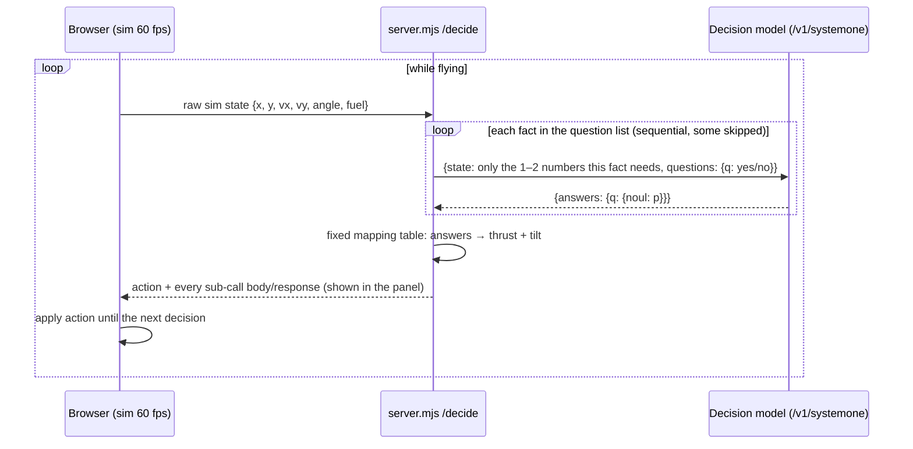

# system1-lander

A 2D lunar lander flown in real time by a small **System 1 decision model** running in Ollama (`/v1/systemone`).
No dependencies: Node ≥ 20 and a browser.


**Main result:** in our tests, a 4B decision model (`tev1:4b`) flying the lander at 1× speed landed **6/6 starts** (avg score 7.87/10, variant `multi2`), answering only tiny yes/no questions about raw physics numbers. Code maps those answers to the controls with a fixed table (details below). This is a small test (6 fixed starts, single runs) on a lenient landing rule, not a general result.

## What is a System 1 decision model?

A decision model doesn't write text. You give it a `state` (text or JSON) and a set of typed `questions`, and it returns calibrated probabilities in one forward pass:

| type | you give | you get back |
|---|---|---|
| `noul` | `instructions` (+ optional `criteria: {true, false}`) | `noul`: probability that the answer is yes, 0–1 |
| `choice` | `instructions` + `criteria: {label: description, …}` | `choice` + `probabilities` per label |
| `score` | `instructions` + ordered `criteria: [low … high]` | `score` (probability-weighted level) + `probabilities` |

Ollama exposes this as `POST /v1/systemone` (its docs say the API follows TypeSafe's Jev API):

```json
{ "model": "tev1:4b",
  "state": { "fall_speed_mps": 4.2 },
  "questions": { "q": { "type": "noul", "instructions": "Is fall_speed_mps greater than 5?",
                        "criteria": { "true": "greater than 5", "false": "5 or less" } } },
  "keep_alive": "30m" }
```
→ `{ "answers": { "q": { "type": "noul", "noul": 0.03 } }, "usage": { "input_tokens": 61, "output_tokens": 1 } }`

`hello.mjs` is a minimal example (no game): `node hello.mjs`.

## How the game works

- `lander/sim.mjs` holds the physics (gravity 1.62 m/s², thrust 4.0 m/s², tilt ±0.35 rad, a 200 m wide world, pad at x 120–150) and all question sets.
- The browser runs the sim at 60 fps. Whenever no decision is in flight, it POSTs the current state to the local server (`/decide`). The server asks the model and returns an action (`burn|coast` × `left|center|right`), and the ship flies with that action until the next one arrives. **Latency is part of the game:** a 700 ms decision means 0.7 s of sim time flying on the old command.
- **Landing rule (deliberately lenient):** on the pad, |vy| < 4 m/s, |vx| < 2 m/s, tilt < 0.3 rad. **Score:** 10 minus deductions (speed, tilt, distance from pad centre) plus a fuel bonus, capped 0–10.
- **Optional rival:** a second ship flown by the model with a personality. First to land wins; both are scored.

### Decision loop



## How the model sees the game (model vs code, precisely)

In the default `multi2` variant, each decision is up to 10 sequential calls, each with a **tiny state** and **one yes/no question**:

| fact | state sent | question |
|---|---|---|
| near_ground | `alt_m` | choice: high / touching_down (alt < 3) |
| rising | `vy_mps` | Is vy_mps positive (moving up)? |
| fall_gt5, fall_gt1, fall_x10 | `fall_speed_mps` (+ `alt_m`) | Is fall speed > 5? > 1? Is fall_speed × 10 > alt_m? |
| pad_right, moving_right | `pad_side`, `sideways_motion` (words) | Is the pad to the right? Moving right? |
| spd_gt3, spd_x8, spd_lt2_5, slow_x8 | `sideways_speed_mps`, `pad_distance_m` | speed > 3? speed × 8 > distance? … |

- **Model does:** read the numbers and answer each fact (comparisons and simple multiplication).
- **Code does:** round the raw state, choose which numbers go into each call, skip facts that earlier answers make irrelevant, and turn the answers into thrust/tilt with a **fixed mapping table** (shown in the panel, `MULTI2_TABLE` in `sim.mjs`).

So the piloting logic, meaning which facts matter and what to do about them, lives in the table, not in the model. The model is a fast, calibrated perception and comparison step. A hand-coded rule with the same thresholds would fly better and with zero latency. The point of the project is to measure what a small decision model can do in a real-time loop.

The panel's "How the model sees the game" section shows, for the latest decision, the raw sim state, every exact body POSTed upstream, and every raw response.

### Rival personalities

The rival's personality is text sent **only to the model**. Three `choice` calls, whose only state is the personality sentence, ask the model what limits it accepts (fall speed above 20 m: 3/5/7 m/s; in the last 20 m: 1/2/3 m/s; sideways: 2/3/4 m/s). Code copies the chosen numbers into the wording of later yes/no questions ("Is fall_speed_mps greater than 3.0?"), and the model answers those. Code never reads the personality. Profile answers are asked once per (model, personality) and then cached.

Measured choices (`tools/probes/personas.mjs`, tev1:4b):

| personality | fall limit high | fall limit low | sideways limit |
|---|---|---|---|
| reckless | 7 (p 0.98) | 3 (0.97) | 4 (0.97) |
| careful | 3 (0.99) | 1 (0.88) | 2 (0.97) |
| show-off | 7 (0.95) | 3 (0.85) | 4 (0.90) |
| fuel-miser | 3 (0.88) | 1 (0.66) | 2 (0.92) |

In effect, show-off ≈ reckless and fuel-miser ≈ careful, so there are two distinct styles, not four.

## Findings (what made the difference)

Each one is backed by a script in `lander/tools/` or a log in `results/`:

1. **Small state + atomic questions beat one big question.** A single 6-way choice question with full physics and piloting rules (~700 input tokens, variants `one`/`two`/`coarse`) landed 0–2/6. Splitting the decision into one fact per call with only the needed numbers (`multi`) reached 6/6 at 1× on the GPU (`results/batch5.log`, `batch8.log`).
2. **Multiplication, not division.** "Is speed > distance / 8?" scored poorly. "Is speed × 8 > distance?" scored much better (`tools/probes/arith-atoms.mjs`).
3. **Key names leak into answers.** Naming a question `near_ground` biased the answer toward "yes" at 50 m altitude. All sub-questions now use the neutral key `q`.
4. **Number formatting matters.** For "Is fall_speed_mps greater than T?", writing T as `3.0` and using `>`/`≤` criteria got 39/40 correct, versus 35/40 for plain `3` with "not greater" (`tools/probes/number-format.mjs`). Errors cluster just above the threshold (e.g. 4 > 3 answered "no").
5. **Option order and relative names bias choices.** Permuting option order changed steering answers (variant `two_perm`, `results/batch3.log`). Directions given as words (`pad_side: right`) worked better than signed numbers.
6. **Prompt caching matters.** Repeated identical prefixes are cheap. Many tiny calls with small, repeating states cost less latency than their count suggests (~60–80 ms each on the GPU).
7. **Host matters more than model size:** see the latency columns below. `nimble:9b` was slower and did not fly better than `tev1:4b`. `tev1:0.8b` is fast but answered facts too inaccurately to land (0/6).

## Results

Six starts, single runs, lenient landing rule, `tools/headless.mjs` unless noted. Hardware: **Mac mini M4 (24 GB)** and an **RTX 4070 Super (12 GB)** box, both running **Ollama 0.40.3**. "Agree" = how often the final action matched a hand-written reference rule (rough).

| variant (what the model answers) | model | host | speed | landed | avg latency | input tok/decision | log |
|---|---|---|---|---|---|---|---|
| `two` (thrust noul + steer choice, full physics + rules) | tev1:4b | Mac | 0.35× | 2/6 | 1348 ms | 682 | batch.log |
| `coarse` (banded numbers) | tev1:4b | Mac | 1× | 0/6 | 1410 ms | 694 | batch.log |
| `hybrid` (code thrust, model steers) | tev1:4b | Mac | 1× | 0/6 | 673 ms | 214 | batch.log |
| `two` | tev1:4b | GPU | 1× | 0/6 | 249 ms | 758 | batch5.log |
| `multi` (atomic yes/no facts) | tev1:4b | GPU | 1× | 3/6 → 6/6* | 618–648 ms | 420–580 | batch5/8.log |
| `multi` | tev1:4b | GPU | 0.35× | 6/6 | 621 ms | 420 | batch5.log |
| `multi` | nimble:9b | GPU | 1× | 0/6 | 804 ms | 1103 | batch5.log |
| `multi` | tev1:0.8b | GPU | 1× | 0/6 | 311 ms | 580 | batch6.log |
| **`multi2`** (+ rising, near-ground level-out, hold) | **tev1:4b** | **GPU** | **1×** | **6/6, avg score 7.87, 28% fuel left** | 747 ms | 563 | batch8.log |
| `multi2p` (+ 0.5 s burn pulse) | tev1:4b | GPU | 1× | 4/6, avg score 5.40, 50% fuel left | 805 ms | 563 | batch8.log |

\* 3/6 before, and 6/6 after, the landing rule was relaxed to the current one.

The older "hints" mode (code pre-computes `too_fast` / `steer left` labels, model just picks) is still selectable for comparison, but its numbers are not in the committed logs.

**Rival, flying alone** (`VARIANT=rival PERSONA=… tools/headless.mjs`, 4 starts, GPU, 1×, `results/batch10.log`):

| personality | landed | avg score | fuel left | flight time | latency |
|---|---|---|---|---|---|
| reckless | 0/4 | 0.00 | 84% | 13–21 s | 1022 ms |
| show-off | 0/4 | 0.00 | 82% | 13–20 s | 1004 ms |
| careful | 1/4 | 1.55 | 47% | 27–55 s | 953 ms |
| fuel-miser | 1/4 | 1.73 | 51% | 36–47 s | 948 ms |

The personalities change behaviour (fast and fuel-light vs slow and fuel-heavy), but the rival rarely lands. An earlier design that asked the model "as a reckless pilot, would you burn now?" made every personality hover until out of fuel (`results/batch9.log`), and was replaced.

**Race: both ships at once, one Ollama host** (`tools/race.mjs`, 4 paired starts, `results/batch11.log`). Ollama serializes requests, so each pilot waits behind the other's sub-calls:

| race | player landed | player latency | rival landed | rival latency |
|---|---|---|---|---|
| vs careful | 3/4 (avg 5.50) | 1094 ms | 1/4 | 1162 ms |
| vs reckless | 2/4 (avg 3.15) | 785 ms | 0/4 | 1523 ms |

Solo player latency is ~750 ms. Sharing the host costs the player roughly 5–45% more latency, and its landing rate drops from 6/6 solo to 2–3/4. (These were cached rival profiles: 7 to 13 sub-calls per decision.)

## Limitations

- The piloting logic is in the mapping table and the choice of facts; the model answers facts. Plain code with the same rules would fly better.
- Small N: 4–6 starts, single runs, one physics setup, a lenient landing rule. Expect variance between runs.
- Latency depends heavily on the host and on Ollama serializing requests (two pilots ≈ double the queueing).
- The model makes threshold errors near boundaries, e.g. 4.0 > 3 → "no" (see finding 4).
- Hosted-provider adapters are untested (see below).

## Run it

Prereqs: Node ≥ 20, [Ollama](https://ollama.com) 0.40.3 or newer with `/v1/systemone`, and a decision model:

```bash
ollama pull tev1:4b          # main model; also tried: tev1:0.8b, nimble:9b
cp .env.example .env         # edit OLLAMA_URL etc. (see Configuration)
npm start                    # → http://localhost:8787
npm run hello                # minimal API example
npm run mock                 # fake /v1/systemone on :11999 for UI work without a model:
                             #   OLLAMA=http://localhost:11999 npm start
```

Headless experiments (each prints per-start results and a SUMMARY line):

```bash
npm run headless                                  # default multi2, 4 fixed starts
VARIANT=multi EXTRA=2 TIME_SCALE=0.35 npm run headless
VARIANT=rival PERSONA=reckless npm run headless
PERSONA=careful npm run race                      # player + rival simultaneously
npm run eval        # decision quality vs a reference rule (one/two-question variants)
npm run eval:multi  # per-fact accuracy for the multi variant
node lander/tools/probes/number-format.mjs        # '3' vs '3.0' comparison probe
npm run check       # node --check on everything
```

## Configuration (.env)

`lander/env.mjs` is a tiny loader: it reads `.env` from the repo root (or `lander/`). Real environment variables override `.env` values. `.env` is git-ignored; `.env.example` documents every key:

| key | default | meaning |
|---|---|---|
| `HOST` / `PORT` | `0.0.0.0` / `8787` | server bind address (0.0.0.0 makes it reachable on the LAN; macOS may ask to allow node) |
| `OLLAMA_URL` | `http://localhost:11434` | primary Ollama |
| `OLLAMA_URL2` | unset | optional secondary Ollama; automatic fallback when the primary is unreachable (remembered 30 s) |
| `OLLAMA_LABEL`, `OLLAMA_LABEL2` | | names shown in the UI host dropdown |
| `PROVIDER` | `primary` | default host: `primary`, `secondary`, `jev`, `msd1`, `openrouter` |
| `MODEL`, `VARIANT`, `MODE`, `TIME_SCALE` | `tev1:4b`, `multi2`, `physics`, `1` | defaults |
| `JEV_*`, `AZURE_*`, `OPENROUTER_*` | unset | hosted decision models (below) |

Example of a split setup, with the model on a GPU box and the game on a laptop:

```
OLLAMA_URL=http://<gpu-box>:11434
OLLAMA_LABEL=GPU box
OLLAMA_URL2=http://localhost:11434
OLLAMA_LABEL2=this machine
```

## Using other decision models

`lander/providers/index.mjs` is a small adapter layer. Every caller builds one Ollama-style `/v1/systemone` body. The adapter rewrites URL, auth header and model name (and drops `keep_alive`), then normalizes the response back to `{answers, usage}`. A provider appears in the UI host dropdown only when its keys are set. Keys are read from env/.env only, never from code.

| provider | set in .env | endpoint used | status |
|---|---|---|---|
| Ollama | `OLLAMA_URL` | `<url>/v1/systemone` | **tested** |
| TypeSafe Jev | `JEV_API_KEY` (`JEV_URL`, `JEV_MODEL=jev-latest`) | `https://api.typesafe.ai/v1/systemone`, `Authorization: Bearer` | untested; same request/response shape per Jev docs |
| Microsoft-Decision-1 on Azure Foundry | `AZURE_ENDPOINT`, `AZURE_API_KEY`, `AZURE_DEPLOYMENT` | `<endpoint>/providers/microsoft/v1/systemone`, `api-key` header, `model` = deployment name | untested; shape per Microsoft Learn docs |
| Microsoft-Decision-1 via OpenRouter | `OPENROUTER_API_KEY` (`OPENROUTER_MODEL=microsoft/microsoft-decision-1`) | assumed `https://openrouter.ai/api/v1/decisions` (override with `OPENROUTER_DECISIONS_URL`), `Authorization: Bearer` | untested; **path assumed** |

Assumptions:
- All three hosted APIs document the same `{model, state, questions}` request with `noul`/`choice`/`score`, and an `answers` map back. Jev documents `noul` with instructions only; we also send `criteria`, which we assume is accepted (Microsoft documents it as optional).
- OpenRouter's model page shows base `https://openrouter.ai/api` and the SDK call `decisions.create`, so we assumed the `/v1/decisions` path. A `{data: {...}}` wrapper is also accepted.
- Hosted latency includes the network round trip. Each lander decision is up to ~10 sequential calls, so expect at least 10× your round-trip time per decision. Hosted calls are paid per token.

The adapter path was exercised offline by pointing `JEV_URL` at the local mock (the request body was rewritten correctly). No paid API was called.

## UI

Top-right buttons and dropdowns: pilot mode, pause, reset, panel, markers, question variant, model, host, rival personality, start positions, time scale. The HUD (top-left) groups **Ship** (alt, vy, vx, tilt, fuel bar), **Pilot** (model@host, action, engine, last decision ms/calls, lag, rate) and **Rival**. Outcomes appear only in the centre banner. The scoreboard (bottom-right, per personality) is saved in localStorage.

| key | action |
|---|---|
| M | AI ↔ manual (arrows: ↑ thrust, ←/→ tilt) |
| P / Space | pause (an in-flight result is held and applied on resume) |
| R | reset / new race |
| S | toggle the System 1 panel |
| T | toggle call markers (○ sent, ● applied, line = latency gap) |
| V | rival on/off |
| ? | help overlay with keys and legend |

## Layout

```
hello.mjs                 minimal /v1/systemone example
lander/
  index.html              game + System 1 panel
  server.mjs              static server + /decide (+ /config)
  sim.mjs                 physics, question sets, mapping tables, scoring
  env.mjs                 .env loader
  providers/index.mjs     Ollama / Jev / Foundry / OpenRouter adapters
  mock-systemone.mjs      fake decision API for UI work
  tools/                  headless, race, evalq, multieval, steerq, tune, steervars
  tools/probes/           small accuracy probes (arithmetic, number format, personas, word facts)
results/                  raw logs behind the tables above (hosts redacted)
docs/screenshot.png
```

## Ideas / next steps

- Ask independent facts in parallel, or several questions in one call, and measure accuracy vs latency.
- Try hosted decision models (Jev, Microsoft-Decision-1) once keys are available, then compare accuracy and latency with the same harness.
- Let the model choose between a few candidate *plans* rather than facts, so more of the logic moves from the table into the model.
- Bigger N, more starts, and harder landing rules; report confidence intervals.
- Give the rival priority, or alternate calls, when two pilots share one host.

## License

Not chosen yet.
