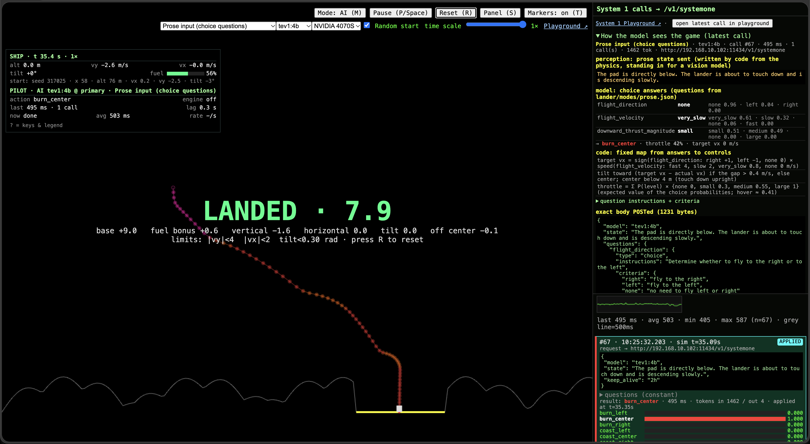
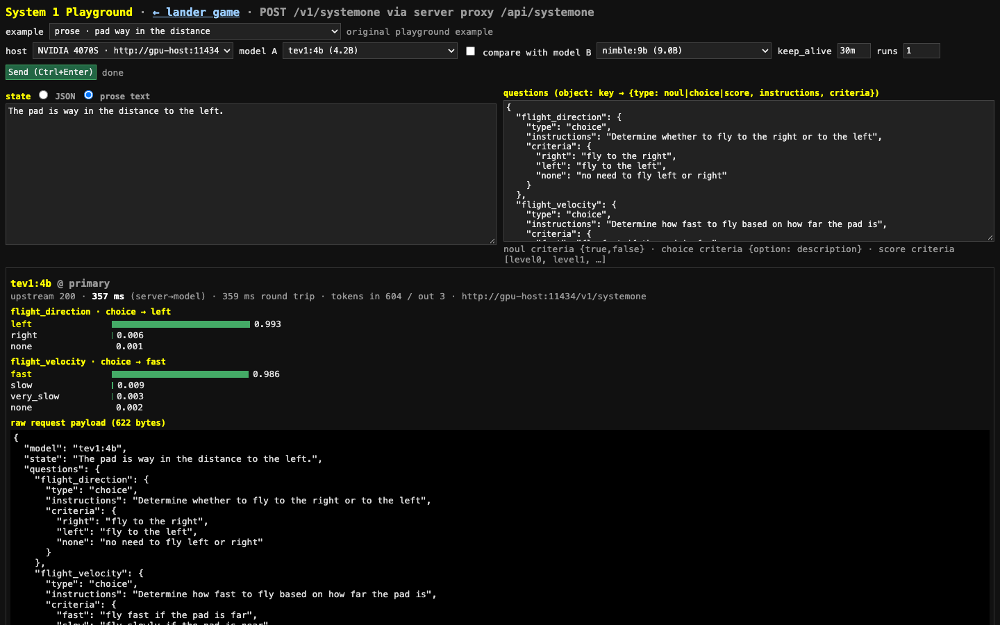

# System 1 Lander

A lunar lander flown in real time by a small **System 1 decision model** through Ollama's `POST /v1/systemone`. The request is a `state` plus `questions` (`noul` yes/no, `choice`, `score`). The reply is the answers with their probabilities, from a single forward pass, with no text generation. Node ≥ 20, no dependencies.



## Run it

```bash
cp .env.example .env        # set OLLAMA_URL (and optionally OLLAMA_URL2 as a fallback host)
ollama pull tev1:4b         # also tried: nimble:9b, tev1:0.8b; also in the menu: d1:3b, nimble-v3:9b (needs Ollama 0.40.4+)
npm start                   # game at http://localhost:8787, playground at /playground
npm run headless            # fly 4 starts without a browser (EXTRA=2 → 6 starts; VARIANT=data|policy:careful|…)
npm run hello               # minimal /v1/systemone example
npm run check               # syntax-check everything
```

`.env` sets the server (`PORT`, `MODEL`, `VARIANT`) and the hosts. Real environment variables override `.env`.

## The three modes

| mode | id | what the model gets → what it decides |
|---|---|---|
| **Prose input (choice questions)** (default) | `prose` | Two prose sentences ("The pad is far to the right. The lander is near the ground (low altitude) and is descending fast.") and 3 `choice` questions with option descriptions (fly direction, fly speed, thrust magnitude). One call per decision. Questions are in `lander/modes/prose.json`. |
| **Data input (yes/no fact checks)** | `data` | A chain of tiny yes/no fact questions about rounded numbers ("Is fall_speed_mps greater than 5?"). One call per fact, up to ~8 per decision. |
| **Policy (plain-English rules)** | `policy:careful` / `fuel-miser` / `aggressive` | A policy text (`lander/modes/policies/*.txt`) plus ship JSON, and 4 judgment questions ("Is the ship falling faster than the policy allows?"). Probabilities are used as graded values. |

In every mode, **code** maps the answers to controls with a small fixed table, shown in the game's System 1 panel. The prose sentences are written by code from the physics, using fixed bands. **They stand in for a vision model**; no vision model is used. To change behavior, edit `prose.json` or a policy file; no code change is needed.

## Results

Headless, 1× time scale (decisions apply after their real latency), 6 starts per row. One NVIDIA RTX 4070 SUPER (12 GB) running Ollama.

| mode | model | landed | avg score | fuel left | ms / decision |
|---|---|---|---|---|---|
| prose | tev1:4b | **6/6** | 7.68 | 47% | 251 |
| prose | nimble:9b | **6/6** | 6.98 | 45% | 310 |
| data | tev1:4b | **6/6** | 7.87 | 28% | 747 |
| policy (careful / fuel-miser / aggressive) | tev1:4b | 1–2/6 | 1.1–1.5 | 44–71% | ~390 |
| prose, **random starts** (seeds 1–6) | tev1:4b | **6/6** | 8.18 | 45% | 327 |

Random starts: x 15–185 m, altitude 50–140 m above the pad, vx ±3 m/s, vy −4…+1 m/s, tilt ±0.15 rad, full fuel (`randomStart(seed)` in `sim.mjs`). In the game, tick **Random start** or use `?random=1` / `?seed=N`. Headless: `RANDOM_START=1 SEED=1 COUNT=6`.

Logs: `results/batch18-criteria.log` (prose), `results/batch20-random-start.log` (random starts), `results/batch17-policy.log` (policy), `results/batch19-verify.log` (prose re-run after the cleanup: 6/6, 7.55, 243 ms). Older `results/` logs are from earlier experiments that have since been removed (see git history).

## What this shows, and what it doesn't

- **Shown:** a small decision model can fly the lander by making **judgments from prose** ("the pad is far to the right" → fly right, fast). Code only maps the named choices to controls.
- **Not shown:** that the model does the control. Code still turns the choices into a target speed, tilt and throttle. The prose comes from code, not from a camera.
- **Small sample:** 6 starts per configuration, one GPU, one physics setup. Treat the differences between the 6/6 rows (score, fuel) as indicative only.

## Key findings

- **Prose + choice questions with option descriptions worked.** 6/6 with both models, one call per decision, the lowest latency of the three modes.
- **Prose where the model picks the raw controls failed.** Earlier "scene" variants (engine on/off, joystick, throttle levels; since removed) got 0/6 across many wordings. The model has to judge the situation, not fly the stick.
- **Policies change behavior, but loosely.** Editing only the policy text changed descent speed and fuel use. Numbers in the policy ("no faster than 3 m/s above 30 m") were followed far better than adjectives ("gentle").
- **The larger model was not better.** nimble:9b matched or trailed tev1:4b and was slower.
- **Latency is mostly prompt prefill.** It scales with input tokens and the number of calls, not with the answer. The data mode's many short calls cost more than one prose call.
- **Switching models costs a reload.** On a 12 GB GPU, switching between nimble:9b and tev1:4b reloads the model (~6–15 s for the first call). Use a long `keep_alive`.

## Decision rate, smoothing and latency (the pilot loop)

`lander/pilot-loop.mjs` sits between the model's answers and the engine. The game and `tools/headless.mjs` both use it. Everything in it is **plain code with fixed limits, not model behavior**. The request body is unchanged; the loop only decides *when* to call and *which* ship state to send.

- **Decision rate** (`decisions` menu, `?rate=1|2|4|5|10`, `DECISION_RATE`; default 4/s, one call per 250 ms of sim time). Headless tests also accept `DECISION_RATE=max`; a `max` saved by an older version resets to 4. It is measured in sim time, so time scale and pause are respected. The next call goes out no sooner than 1/rate sim-seconds after the previous one was sent, and only one call is ever in flight. The HUD shows the target rate and the rate actually achieved.
- **Smoothing** (`?smooth=`, `SMOOTHING`; default on). A reply sets a target throttle and tilt. The throttle eases toward its target with a 0.15 s time constant, and the tilt slews at most 2 rad/s.
- **Latency compensation** (`?comp=`, `LATENCY_COMP`; default on). The request carries the ship state predicted for when the reply will land: the current state, propagated forward by the recent average reply age under the current controls. A reply older than 1.5 sim-seconds is discarded, but only while a fresher target is still in force; if every reply is slow, an old answer beats none. The HUD shows `LATE REPLY` while waiting longer than that.
- **Impulse limits** (`?impulse=`, `IMPULSE_LIMITS`; default on). These are safety limits in code:
  - **Burn lease.** A throttle target is valid for max(1/rate, 0.4 s) of sim time. After that, without a new answer, the throttle eases down to hover (about 0.41), or to 0 if the ship is already rising.
  - **Climb guard.** If the ship is rising faster than 1 m/s, the throttle is capped at half of hover.
  - Late replies keep the last **steering** target, but never a full burn.
  - No per-command impulse budget was needed after these two.
- **Same-scene skip** (`SAME_SCENE_SKIP=0` turns it off). In prose mode the scene sentences change only when the ship crosses a band, so most calls repeat the previous body byte for byte. The server reuses the last answer for an identical body less than 1 sim-second old instead of calling the model. The HUD counts these as `skipped (same scene)`. Calls that are made send exactly the same body as before.
- **Testing slow hosts:** `?delay=ms` (or `DELAY_MS`) adds artificial latency to every reply.

Pilot-loop results (Mac mini Ollama, tev1:4b on the MLX runner (mxfp8); the Mac moved from Ollama 0.40.3 to 0.40.5 during this work, and these rows predate the 4/s default and the same-scene skip; tev1:4b, prose mode, random seeds 1–6). Latency is per call; with `DELAY_MS`, the delay is included.

| setting | landed | avg score | fuel left | actual rate | avg latency | flew away |
|---|---|---|---|---|---|---|
| rate 2, defaults | 5/6 | 5.95 | 56% | 1.7/s | 137 ms | 0 |
| **rate 5, defaults** | **5/6** | **5.50** | 60% | 3.8/s | 81 ms | 0 |
| rate 10, defaults | 4/6 | 4.62 | 61% | 7.5/s | 39 ms | 0 |
| rate max, defaults | 4/6 | 4.72 | 59% | 44.9/s | 11 ms | 0 |
| rate max, smoothing off | 5/6 | 5.57 | 59% | 45.1/s | 11 ms | 0 |
| rate max, everything off (old behavior) | 6/6 | 6.95 | 51% | 45.4/s | 11 ms | 0 |
| delay 600 ms, compensation on | 5/6 | 5.90 | 59% | 1.2/s | 758 ms | 0 |
| delay 600 ms, compensation off | 4/6 | 5.20 | 62% | 1.2/s | 752 ms | 0 |
| **delay 1200 ms, defaults** | **5/6** | **5.97** | 65% | 0.6/s | 1483 ms | 0 |
| delay 1200 ms, compensation off | 2/6 | 2.43 | 70% | 0.6/s | 1503 ms | 0 |
| delay 1200 ms, impulse limits off | 0/6 | 0.00 | 0% | 0.7/s | 1467 ms | 0 |
| delay 1200 ms, everything off (old behavior) | 0/6 | 0.00 | 0% | 0.6/s | 1695 ms | 1 |

The two bold rows use the current defaults. The other smoothing-on rows ran with an earlier 1.5 rad/s tilt limit; at rate 5 that limit landed 4/6 (score 4.72) against 5/6 with 2 rad/s, which is why the default is now 2. With a fast host, the old "as fast as possible, no smoothing" loop lands best; these six seeds can't tell the 5/6 settings apart. With a slow host, latency compensation and the impulse limits decide the outcome. Without the limits, a held burn emptied the tank on every flight (and one ship flew out of the world). Seed 1 is the usual crash in every setting: it drifts in sideways at just over 2 m/s.

### Why the Mac answers in ~10 ms: prompt cache hits

The very fast Mac latencies are mostly cache hits, not fast inference. Measured on the Mac mini (Ollama 0.40.5, tev1:4b, MLX mxfp8):

- An identical prose body comes back in about 5–11 ms. Ollama reports `prompt_eval_cached_count` 621 of 621 input tokens, so nothing is evaluated.
- A changed scene shares only about 200 cached tokens of the template. It takes about **1.2 s** (median of 8 distinct scenes: 1191 ms), and so does a body with only a random suffix added.
- Alternating between two scenes still hits for both, so several entries are cached.
- The answers follow the scene sensibly: pad left gives `left`, about to touch down falling very fast gives `large` thrust, rising gives `small`. A hit is always for the identical body, so its answer is never stale. The hello.mjs JSON states (about 160 tokens) take about 340 ms per new state.
- A cold call after unloading took 4.5 s.
- Flights: at 4/s, prose flights see about 9 unique scenes each, and 150 of 286 calls in six flights were skipped as the same scene. At `max`, a flight made about 1,660 calls for about 12 unique scenes, so over 99% of calls were cache hits.
- MLX vs llama.cpp Q8_0 on the Mac (`tev1:4b` vs `tev1:4b-q8_0`, same answers on 90/90 probes):
  - MLX: changed-scene median 16 ms (p90 2235 ms), repeat median 5 ms.
  - Q8_0: changed median 1589 ms (p90 2209 ms), and a repeat still costs 1522 ms; this setup showed no cache benefit.

So on the Mac, a real new decision costs about 1.2 s, and the ~10 ms figure is the cache. The 4/s default and the same-scene skip avoid paying for repeats, and latency compensation covers the real ~1.2 s misses.

Flights at the 4/s default (Mac, seeds 1–6): landed 4/6, avg score 4.48, 72% fuel left, actual 1.7/s. The Mac was also serving gemma4:12b-mlx for another task at the time, and some calls stalled for 2–22 s.

### Prompt tuning and flat approach zones (Mac, tev1:4b, prose, random seeds 1–6, 4/s)

The Mac had only tev1:4b and a small embedding model loaded for most runs; gemma4:12b-mlx was loaded briefly during variant B. `tools/proseprobe.mjs` now also asks full in-flight scenes (pad sentence + altitude sentence, all three questions in one call, both sides).

| prose.json | probe dir / vel / thrust (isolated) | full scenes dir / vel / thrust (of 36) | landed | avg score |
|---|---|---|---|---|
| before | 9/9, 6/9, 12/20 | 33, 24, 18 | 4/6 | 4.85 |
| B: thrust criteria rewritten to match the probe | 9/9, 9/9, 17/20 | 33, 30, 34 | 1/6 | 1.40 |
| C: velocity wording only | 9/9, 9/9 (thrust as before) | 33, 30 (thrust as before) | 5/6, 5/6 | 5.70, 5.85 |
| D: C + "more thrust if the pad is far and the ship is low" in the instructions | – | – | 1/6 | 1.23 |
| **F: C + pad-aware `medium` criterion** (current) | 9/9, 9/9, 13/20 | 33, 30, 21 | 5/6 | 5.60 |
| **F + flat approach zones** (current default) | | | **6/6** | **6.85** |

- **Direction was healthy all along.** Both sides got it right, in isolation and in full scenes. The only misses were `none` when about to touch down, where code levels the ship anyway. Rewording the direction criteria with "because the pad is to the right" broke it (4/9, with mirrored flips), so that wording was reverted.
- **Velocity:** "very near, just a little to one side" in the `very_slow` criterion fixed "very near → slow (2 m/s)", one cause of touching down sideways at more than 2 m/s.
- **Thrust: probe accuracy is not landing success.** Criteria that "fixed" the probe (medium when descending slowly near the ground, thrust while rising) made the ship hover until the tank was empty: medium (0.55) is above hover (0.41). The kept change only adds "or the pad is still far away and the lander is getting low" to `medium`, so the model weighs both sentences. That got seed 1, the usual crash, to land.
- **Flat approach zones** (`APPROACH` in `sim.mjs`): the model cannot see terrain. The ground is now pad height within 20 m of every pad edge (`PADS`), and the bumps grow back smoothly over the next 25 m. This applies to every start, random or fixed.

Logs: `results/batch21-*.log`.

## Playground

`/playground` sends any `/v1/systemone` request through the server (no CORS issue; input is validated).
- **Request:** pick the host and model (listed from the host's `/api/tags`). Edit the state as JSON or prose, the questions as JSON, and `keep_alive`.
- **Results:** probability bars, score, latency and tokens, and the raw request and response. Run N times to see variance, or compare two models side by side.
- **Examples:** the three game modes, the original prose examples, hello.mjs, ticket triage and a tool-call safety check.
- **From the game:** "open latest call in playground" loads the current call.
- **URL params:** `?example=<id>&model=<name>&compare=<name>&run=1` loads and sends an example; `?redact=1` (game or playground) masks host IPs, for screenshots.



## Using other providers

`lander/providers/index.mjs` has adapters for TypeSafe Jev and Microsoft Decision-1 (Azure Foundry and OpenRouter). They are written from public docs and are **untested** (no keys). Only Ollama is tested. Configure them in `.env`; they show up in the host dropdowns.

## Layout

For where the model calls happen, see the [code walkthrough](docs/code-walkthrough.md).

```
lander/server.mjs        HTTP server, the 3 modes, playground proxy (/api/systemone, /api/models, /api/examples)
lander/sim.mjs           physics + data-mode questions (shared with the browser)
lander/pilot-loop.mjs    decision rate, smoothing, latency compensation, impulse limits (browser + headless)
lander/prose.mjs         perception bands → prose sentences, prose-mode control map
lander/policy.mjs        policy-mode questions and map
lander/modes/            prose.json, policies/*.txt (edit these to change behavior)
lander/index.html        game page: game.js (logic), game.css
lander/playground.html   playground page: playground.js, playground.css
lander/tools/            headless.mjs (fly), proseprobe.mjs (offline question probe)
```

## License

MIT © 2026 Andrew Rapo — see LICENSE
