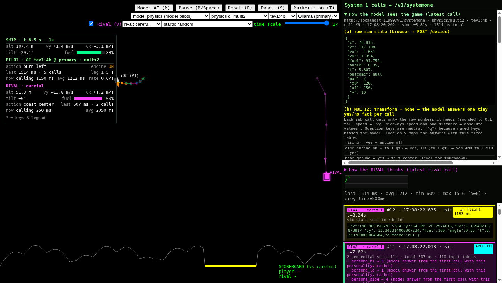
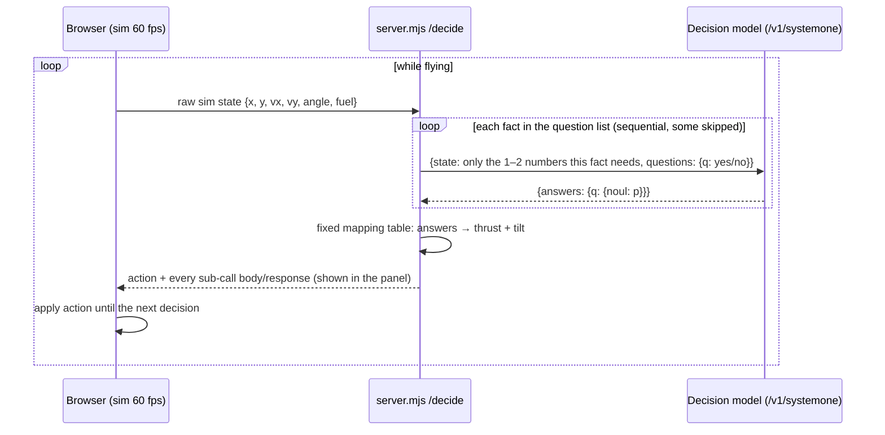
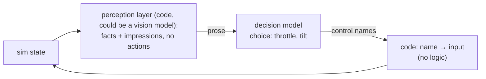

# system1-lander

A 2D lunar lander flown in real time by a small **System 1 decision model** running in Ollama (`/v1/systemone`).
No dependencies: Node ≥ 20 and a browser.



**Main result:** in our tests, a 4B decision model (`tev1:4b`) flying the lander at 1× speed landed **6/6 starts** (avg score 7.87/10, variant `multi2`), answering only tiny yes/no questions about raw physics numbers. Code maps those answers to the controls with a fixed table (details below). This is a small test (6 fixed starts, single runs) on a lenient landing rule, not a general result.

## What is a System 1 decision model?

A decision model doesn't write text. You give it a `state` (text or JSON) and a set of typed `questions`, and it returns calibrated probabilities in one forward pass:

| type | you give | you get back |
|---|---|---|
| `noul` | `instructions` (+ optional `criteria: {true, false}`) | `noul`: probability that the answer is yes, 0–1 |
| `choice` | `instructions` + `criteria: {label: description, …}` | `choice` + `probabilities` per label |
| `score` | `instructions` + ordered `criteria: [low … high]` | `score` (probability-weighted level) + `probabilities` |

Ollama exposes this as `POST /v1/systemone` (its docs say the API follows TypeSafe's Jev API):

```json
{ "model": "tev1:4b",
  "state": { "fall_speed_mps": 4.2 },
  "questions": { "q": { "type": "noul", "instructions": "Is fall_speed_mps greater than 5?",
                        "criteria": { "true": "greater than 5", "false": "5 or less" } } },
  "keep_alive": "30m" }
```
→ `{ "answers": { "q": { "type": "noul", "noul": 0.03 } }, "usage": { "input_tokens": 61, "output_tokens": 1 } }`

`hello.mjs` is a minimal example (no game): `node hello.mjs`.

## How the game works

- `lander/sim.mjs` holds the physics (gravity 1.62 m/s², thrust 4.0 m/s², tilt ±0.35 rad, a 200 m wide world, pad at x 120–150) and all question sets.
- The browser runs the sim at 60 fps. Whenever no decision is in flight, it POSTs the current state to the local server (`/decide`). The server asks the model and returns an action (`burn|coast` × `left|center|right`), and the ship flies with that action until the next one arrives. **Latency is part of the game:** a 700 ms decision means 0.7 s of sim time flying on the old command.
- **Landing rule (deliberately lenient):** on the pad, |vy| < 4 m/s, |vx| < 2 m/s, tilt < 0.3 rad. **Score:** 10 minus deductions (speed, tilt, distance from pad centre) plus a fuel bonus, capped 0–10.
- **Optional rival:** a second ship flown by the model with a personality. First to land wins; both are scored.

### Decision loop



## How the model sees the game (model vs code, precisely)

In the default `multi2` variant, each decision is up to 10 sequential calls, each with a **tiny state** and **one yes/no question**:

| fact | state sent | question |
|---|---|---|
| near_ground | `alt_m` | choice: high / touching_down (alt < 3) |
| rising | `vy_mps` | Is vy_mps positive (moving up)? |
| fall_gt5, fall_gt1, fall_x10 | `fall_speed_mps` (+ `alt_m`) | Is fall speed > 5? > 1? Is fall_speed × 10 > alt_m? |
| pad_right, moving_right | `pad_side`, `sideways_motion` (words) | Is the pad to the right? Moving right? |
| spd_gt3, spd_x8, spd_lt2_5, slow_x8 | `sideways_speed_mps`, `pad_distance_m` | speed > 3? speed × 8 > distance? … |

- **Model does:** read the numbers and answer each fact (comparisons and simple multiplication).
- **Code does:** round the raw state, choose which numbers go into each call, skip facts that earlier answers make irrelevant, and turn the answers into thrust/tilt with a **fixed mapping table** (shown in the panel, `MULTI2_TABLE` in `sim.mjs`).

So the piloting logic, meaning which facts matter and what to do about them, lives in the table, not in the model. The model is a fast, calibrated perception and comparison step. A hand-coded rule with the same thresholds would fly better and with zero latency. The point of the project is to measure what a small decision model can do in a real-time loop.

The panel's "How the model sees the game" section shows, for the latest decision, the raw sim state, every exact body POSTed upstream, and every raw response.

### Rival personalities

The rival's personality is text sent **only to the model**. Three `choice` calls, whose only state is the personality sentence, ask the model what limits it accepts (fall speed above 20 m: 3/5/7 m/s; in the last 20 m: 1/2/3 m/s; sideways: 2/3/4 m/s). Code copies the chosen numbers into the wording of later yes/no questions ("Is fall_speed_mps greater than 3.0?"), and the model answers those. Code never reads the personality. Profile answers are asked once per (model, personality) and then cached.

Measured choices (`tools/probes/personas.mjs`, tev1:4b):

| personality | fall limit high | fall limit low | sideways limit |
|---|---|---|---|
| reckless | 7 (p 0.98) | 3 (0.97) | 4 (0.97) |
| careful | 3 (0.99) | 1 (0.88) | 2 (0.97) |
| show-off | 7 (0.95) | 3 (0.85) | 4 (0.90) |
| fuel-miser | 3 (0.88) | 1 (0.66) | 2 (0.92) |

In effect, show-off ≈ reckless and fuel-miser ≈ careful, so there are two distinct styles, not four.

## Findings (what made the difference)

Each one is backed by a script in `lander/tools/` or a log in `results/`:

1. **Small state + atomic questions beat one big question.** A single 6-way choice question with full physics and piloting rules (~700 input tokens, variants `one`/`two`/`coarse`) landed 0–2/6. Splitting the decision into one fact per call with only the needed numbers (`multi`) reached 6/6 at 1× on the GPU (`results/batch5.log`, `batch8.log`).
2. **Multiplication, not division.** "Is speed > distance / 8?" scored poorly. "Is speed × 8 > distance?" scored much better (`tools/probes/arith-atoms.mjs`).
3. **Key names leak into answers.** Naming a question `near_ground` biased the answer toward "yes" at 50 m altitude. All sub-questions now use the neutral key `q`.
4. **Number formatting matters.** For "Is fall_speed_mps greater than T?", writing T as `3.0` and using `>`/`≤` criteria got 39/40 correct, versus 35/40 for plain `3` with "not greater" (`tools/probes/number-format.mjs`). Errors cluster just above the threshold (e.g. 4 > 3 answered "no").
5. **Option order and relative names bias choices.** Permuting option order changed steering answers (variant `two_perm`, `results/batch3.log`). Directions given as words (`pad_side: right`) worked better than signed numbers.
6. **Prompt caching matters.** Repeated identical prefixes are cheap. Many tiny calls with small, repeating states cost less latency than their count suggests (~60–80 ms each on the GPU).
7. **Host matters more than model size:** see the latency columns below. `nimble:9b` was slower and did not fly better than `tev1:4b`. `tev1:0.8b` is fast but answered facts too inaccurately to land (0/6).

## Results

Six starts, single runs, lenient landing rule, `tools/headless.mjs` unless noted. Hardware: **Mac mini M4 (24 GB)** and an **RTX 4070 Super (12 GB)** box, both running **Ollama 0.40.3**. "Agree" = how often the final action matched a hand-written reference rule (rough).

| variant (what the model answers) | model | host | speed | landed | avg latency | input tok/decision | log |
|---|---|---|---|---|---|---|---|
| `two` (thrust noul + steer choice, full physics + rules) | tev1:4b | Mac | 0.35× | 2/6 | 1348 ms | 682 | batch.log |
| `coarse` (banded numbers) | tev1:4b | Mac | 1× | 0/6 | 1410 ms | 694 | batch.log |
| `hybrid` (code thrust, model steers) | tev1:4b | Mac | 1× | 0/6 | 673 ms | 214 | batch.log |
| `two` | tev1:4b | GPU | 1× | 0/6 | 249 ms | 758 | batch5.log |
| `multi` (atomic yes/no facts) | tev1:4b | GPU | 1× | 3/6 → 6/6* | 618–648 ms | 420–580 | batch5/8.log |
| `multi` | tev1:4b | GPU | 0.35× | 6/6 | 621 ms | 420 | batch5.log |
| `multi` | nimble:9b | GPU | 1× | 0/6 | 804 ms | 1103 | batch5.log |
| `multi` | tev1:0.8b | GPU | 1× | 0/6 | 311 ms | 580 | batch6.log |
| **`multi2`** (+ rising, near-ground level-out, hold) | **tev1:4b** | **GPU** | **1×** | **6/6, avg score 7.87, 28% fuel left** | 747 ms | 563 | batch8.log |
| `multi2p` (+ 0.5 s burn pulse) | tev1:4b | GPU | 1× | 4/6, avg score 5.40, 50% fuel left | 805 ms | 563 | batch8.log |

\* 3/6 before, and 6/6 after, the landing rule was relaxed to the current one.

The older "hints" mode (code pre-computes `too_fast` / `steer left` labels, model just picks) is still selectable for comparison, but its numbers are not in the committed logs.

**Rival, flying alone** (`VARIANT=rival PERSONA=… tools/headless.mjs`, 4 starts, GPU, 1×, `results/batch10.log`):

| personality | landed | avg score | fuel left | flight time | latency |
|---|---|---|---|---|---|
| reckless | 0/4 | 0.00 | 84% | 13–21 s | 1022 ms |
| show-off | 0/4 | 0.00 | 82% | 13–20 s | 1004 ms |
| careful | 1/4 | 1.55 | 47% | 27–55 s | 953 ms |
| fuel-miser | 1/4 | 1.73 | 51% | 36–47 s | 948 ms |

The personalities change behaviour (fast and fuel-light vs slow and fuel-heavy), but the rival rarely lands. An earlier design that asked the model "as a reckless pilot, would you burn now?" made every personality hover until out of fuel (`results/batch9.log`), and was replaced.

**Race: both ships at once, one Ollama host** (`tools/race.mjs`, 4 paired starts, `results/batch11.log`). Ollama serializes requests, so each pilot waits behind the other's sub-calls:

| race | player landed | player latency | rival landed | rival latency |
|---|---|---|---|---|
| vs careful | 3/4 (avg 5.50) | 1094 ms | 1/4 | 1162 ms |
| vs reckless | 2/4 (avg 3.15) | 785 ms | 0/4 | 1523 ms |

Solo player latency is ~750 ms. Sharing the host costs the player roughly 5–45% more latency, and its landing rate drops from 6/6 solo to 2–3/4. (These were cached rival profiles: 7 to 13 sub-calls per decision.)

## Experiment: scene mode (the model owns the decision)

In `multi`/`multi2` the piloting logic lives in the code's mapping table. Scene mode tries the opposite: **perception layer → decision model → controls.** The model gets a prose description of the situation and picks the controls itself. Code only maps control names to inputs (`sceneRead` in `sim.mjs`).



Variants (all in the UI variant dropdown as `scene_*`; the panel shows the exact prose, the perception sentences, and the chosen control):

| variant | prose | output |
|---|---|---|
| `s1` | facts with numbers: "You are 42 meters above the ground, falling at 6.0 meters per second. The landing pad's center is 30 meters to your right…" | `a` one 6-way choice · `b` engine noul + tilt choice · `c` three nouls |
| `s2` | the same facts as words from fixed bins ("high", "falling quickly"). A gray area: the bin edges are code choices, but they describe size, not what to do | a / b / c |
| `s3` | s1 + the last 2 decisions as short "frames" (state + what you chose) | a / b / c |
| `s4` | s1 + **perception impressions** | a / b / c |
| `s1t*`, `s4t*` | s1 / s4 with **graded throttle** (off / low / medium / high = 0, 0.3, 0.55, 1.0 × thrust; fuel burn proportional). `p` = adds "Last command: low thrust, tilt none", `n` = without it, `r` = options listed in reverse order | throttle choice + tilt choice |

**Judgments the perception layer makes (code, `perceive()` in `sim.mjs`):**
- descent compared with a height-scaled comfort speed (alt/10, clamped 0.7–5 m/s): "falling too fast for this height", "about right", "descending slowly", "rising";
- sideways approach compared with a distance-scaled pace (distance/8, clamped to 3 m/s): "will overshoot the pad", "will fall short of it", "on track", "drifting away", "over the pad";
- tilted noticeably (> 5°), close to the ground (< 10 m), fuel running low (< 20%).

It **never** names an action. That is the difference from the old hints mode, whose labels named the action directly (`engine: burn`, `steer: left`). Here the model still has to turn "too fast" into "more throttle" and "will fall short of the pad to your right" into "tilt right with the engine on".

The mission (land gently and upright on the pad, save fuel, survivable limits) and how the controls work (gravity 1.6 m/s², engine along the ship's axis, tilt only pushes sideways while the engine fires) are in the question instructions, the same for every variant.

### Results

**Offline**, 24 states vs the rule reference (`tools/sceneeval.mjs`, `results/scene-eval.txt`). A constant "engine off, upright" already scores about 13/24 engine and 17/24 tilt on this set.

| model | factual s1/s2/s3 (best) | perception s4 (best) |
|---|---|---|
| tev1:4b | engine 14/24, both 9/24 (≈ the constant baseline) | engine 17/24, both 15/24 (`s4b`) |
| nimble:9b | engine 17/24, both 13/24 (`s1a`) | not run |
| tev1:0.8b | 13–14/24: answers "engine off, upright" almost every time | not run |

**Throttle vs the last command** (`tools/probes/throttle-adjust.mjs`). Here the model clearly does what the user hoped:
- **With perception (`s4tp`, tev1:4b):** "too fast" + last command low → medium (3/3); "too fast" from off or medium → steps up (9/9); "slow" never steps up, and steps down from medium or high (5/6).
- **With factual prose only (`s1tp`):** the model mostly **copies the last command** (e.g. "about right" + last high → high, 3/3).
- **Order bias:** listing the options high→off changed answers (e.g. too fast + last high → medium instead of staying at high).

**Flying**, 6 starts each, NVIDIA host (`results/batch12a.log`, `batch13.log`):

| variant | model | speed | landed | avg score | fuel left | latency | typical failure |
|---|---|---|---|---|---|---|---|
| `scene_s4tn` (perception, throttle, no last command) | tev1:4b | 1× | 1/6 | 1.35 (one 8.1 landing) | 68% | 312 ms | off pad: steering toward the pad fails |
| `scene_s4tp` (perception + last command) | tev1:4b | 1× | 0/6 | 0.00 | 79% | 337 ms | off pad |
| `scene_s1tp` (facts + last command) | tev1:4b | 1× | 0/6 | 0.00 | 15% | 309 ms | latches high throttle, climbs ~670 m, runs out of fuel |
| `scene_s4a` (perception, 6-way choice) | tev1:4b | 1× | 0/6 | 0.00 | 4% | 137 ms | climbs (≈2.7 km), runs out of fuel |
| `scene_s1a` (facts, 6-way choice) | tev1:4b | 1× | 0/6 | 0.00 | 19% | 133 ms | climbs |
| `scene_s4tp` | nimble:9b | 1× | 0/6 | 0.00 | 34% | 418 ms | climbs / off pad |
| `scene_s4tn` | tev1:4b | 0.5× | 0/6 | 0.00 | 69% | 312 ms | off pad |
| `scene_s4tp` | tev1:4b | 0.5× | 1/6 | 1.27 | 75% | 306 ms | off pad |
| for comparison: **`multi2`** (atomic facts + mapping table) | tev1:4b | 1× | **6/6** | **7.87** | 28% | 747 ms | — |

**Verdict:** when the model owns the decision from prose, it doesn't fly the lander, in our tests. With perception impressions it handles the **vertical** axis sensibly (throttle steps up when "too fast", down when "slow"), and the descent is usually survivable. It fails on the **horizontal** axis: it doesn't reliably translate "the pad is to your right and you'll fall short" into "tilt right" (most crashes are off-pad). Without impressions (factual numbers only), the models mostly ignore the numbers or copy the last command, and either fall or climb away. Larger nimble:9b did not fix this.

So the perception layer carries real weight, and the remaining gap is in turning a description into a sideways manoeuvre. Possible next steps: impressions that state the geometry more directly (still without actions), few-shot examples in the instructions, or splitting throttle and tilt into separate calls with only the relevant impressions.

### Steering-wording bench

Scene mode failed mostly on steering, so `lander/tools/steerbench.mjs` isolates that question with no game: direct `/v1/systemone` calls, perception prose fixed, only the steering wording varied. The test set has 40 balanced states (pad left / right / below × drifting toward / away / still × slow / fast). The reference answer comes from a simple documented rule: over the pad, steer against drift above 1 m/s; moving away or still → toward the pad; approaching too fast (> 1.3 × distance/8 + 0.3) → away; too slow → toward; else none. Reference mix: left 16, right 14, none 10, so always answering "left" scores 40%. Results are in `results/steer-bench.txt` (plus `steer-bench-full-run.log`).

| wording (choice, neutral option first) | tev1:4b | nimble:9b | tev1:0.8b |
|---|---|---|---|
| **joystick left / center / right + "pad is ahead-right of you, N m away"** | **91%** (order bias 13%) | — | — |
| press LEFT / RIGHT / no input + "ahead-right" | 90% (bias 5%) | — | — |
| joystick left / center / right | 84% | 74% | 41% |
| press LEFT / press RIGHT / no input | 83% | 75% | 43% |
| tilt left / tilt right / stay level | 79% | 74% | 33% |
| move left / right / stay | 78% | 75% | 26% |
| fly left / right / hold | 76% | 76% | 35% |
| push left / right / none, thrust sideways left / right | 69% | 73% | 38–41% |
| pad as x positions instead of "to your right" | 79% | | |
| per-direction yes/no ("Joystick left?" + "Joystick right?") | 28–40% | | |

- **Framing:** game/joystick framing beats physical framing ("push", "thrust sideways").
- **Pad wording:** "ahead-right of you, 75 m away" beats "the pad's centre is 75 m to your right" and x positions.
- **Control explanations hurt:** adding a sentence like "tilting left pushes the ship left" lowered tev1:4b by 3–12 points.
- **Last steering command:** adding it didn't help.
- **Yes/no form is bad:** per-direction yes/no answers "no" to both most of the time.
- **Model size:** nimble:9b is flat at about 75% whatever the wording. tev1:0.8b is near chance, and its answers change with option order 45–85% of the time.
- **Option order:** with 6 orders, tev1:4b's answer still changes for 10–20% of states.
- **Remaining errors:** mostly "none" states answered with a direction.

The best wording is in the UI as `scene_s4tjn` / `scene_s4tjp` (perception + throttle + joystick + "ahead" pad wording, without / with the last command).

**Flown** (6 starts, 1×, tev1:4b, `results/batch14.log`): `scene_s4tjn` 0/6, 64% fuel left, 308 ms; `scene_s4tjp` 0/6, 47% fuel left, 308 ms. Most crashes are now gentle touchdowns **off the pad** (vertical speed fine). 91% per-decision steering accuracy is not enough when ~100 decisions are chained; the joystick also flips between left and right.

### Qualitative bands only (s5)

`scene_s5*` describes the scene **with no numbers at all**, using fixed bands (thresholds in `proseS5()`, `sim.mjs`):

| quantity | bands |
|---|---|
| vertical | rising fast (> 2 m/s) · rising slowly · hovering (\|vy\| ≤ 0.3) · falling very slowly (< 1.5) · falling slowly (< 3.5) · falling fast (< 6) · falling very fast |
| altitude | very high (> 80 m) · medium high (> 40) · low (> 15) · very low (> 5) · nearly on the ground |
| pad | directly below (≤ 15 m) · a little (< 40) · a lot (< 80) · very far to the left/right |
| sideways | not drifting (< 0.3 m/s) · slowly (< 1.5) · fast (< 3.5) · very fast, left/right |
| tilt / fuel | upright (< 5°) · slightly (< 12°) · strongly left/right · fuel plenty (> 60%) · about half · low · almost empty |

Variants: `s5tjp` = bands + perception impressions + last command; `s5bjp` = bands + last command, no impressions. Both use joystick steering and graded throttle.

| | steering bench, tev1:4b (joystick) | nimble:9b | throttle vs last command | flown 6 starts, 1× | latency |
|---|---|---|---|---|---|
| numeric + "ahead" (`s4tjp`) | 91% | 83% | adjusts (too fast → up 9/9) | 0/6 (off-pad touchdowns) | 308 ms |
| bands + impressions (`s5tjp`) | 81% | 66% | adjusts in the probe (at 50 m) | **0/6, 100% fuel left**: never fires the engine while "very high", even "falling very fast" | 224 ms |
| bands only (`s5bjp`) | 80% | 68% | **copies the last command** in every case | 0/6, 100% fuel left | 201 ms |

(`results/steer-bench-s5.txt`, `results/batch15.log`.)

**nimble:9b flown on the joystick/bands variants** (`results/batch16-nimble.log`, 1×, 6 starts each):

| variant | landed | avg score | fuel left | ms/decision | failure mode |
|---|---|---|---|---|---|
| `s4tjn` | 0/6 | 0.00 | 45% | ~406 | drifts sideways out of bounds (5/6), 1 off-pad; little climbing |
| `s4tjp` | 0/6 | 0.00 | 0% | ~406 | climbs (~950 m avg), runs out of fuel, falls (~60 m/s) |
| `s5tjp` | 0/6 | 0.00 | 0% | 304 | climbs (~900 m avg), out of fuel, falls |
| `s5bjp` | 0/6 | 0.00 | 0% | 302 | climbs (~1150 m avg), out of fuel, falls / timeout |

nimble:9b does no better than tev1:4b (also 0/6 on all four). On s5, tev1:4b never fires the engine. nimble:9b does the opposite: it holds thrust and climbs away. `multi2` (tev1:4b, 6/6) is still the only setup that lands.

**Takeaways:**
- **Bands lose steering accuracy:** 10 points for tev1:4b, about 17 for nimble:9b. Most of the loss is on "no steering needed" states.
- **Bands hurt vertical control in flight:** "very high" seems to read as "safe", so the engine stays off until it's too late.
- **Latency:** about 25–35% lower (201–224 vs 308 ms). Part of that is fewer input tokens; repeated band phrases probably also help Ollama's prompt cache, but we didn't measure cache hits directly.
- **For tev1:4b, numbers plus impressions beat bands.**

**Model vs code, restated:** in `multi2` the model answers facts and the code decides. In scene mode the code describes (the perception layer: facts + impressions) and the model decides. Today the first flies and the second doesn't.

## Experiment: policy pilot (judgment questions against a plain-English policy)

The yes/no fact questions are things code could compute. In **policy** mode the model makes judgments instead. Each call's state is `{ policy, ship }`. `policy` is the text of `lander/policies/<name>.txt`; `ship` is compact JSON with named fields (height, vertical speed, pad direction and distance, sideways motion relative to the pad, fuel, crash limits). Each decision asks 4 `noul` questions (neutral key `q`, `keep_alive: '2h'`, ~390 ms in total). The questions are in `lander/policy.mjs`:

- `too_fast`: is the ship falling faster than the policy allows at its height?
- `too_slow`: is it falling slower than it needs to, or climbing?
- `go_right` / `go_left`: does the ship need more rightward / leftward speed (sideways speed must shrink near the pad)?

Code maps the **probabilities** (graded, not a 0.5 cutoff) with a fixed table:
`throttle = clamp(0.41 + 0.9·P(too_fast) − 0.9·P(too_slow), 0, 1)` (0.41 = hover); `steer = P(right) − P(left)`, ±0.15 deadband; tilt center below 4 m.
**To change behavior, edit the policy text, not code.** Select it with `VARIANT=policy POLICY=careful` (headless) or `physics q: policy:careful` (UI). The System 1 panel shows the policy text, the ship JSON, each probability, and the mapping.

Results (`results/batch17-policy.log`, tev1:4b, 1×, 6 starts):

| round | policy | landed | avg score | fuel left | ms/decision | max fall | flight time | failure modes |
|---|---|---|---|---|---|---|---|---|
| 1 (push right/left wording) | careful (prose) | 0/6 | 0.00 | 65% | 374 | ~4.7 | ~30 s | 5 off-pad at vx ≈ 3 (never brakes sideways), 1 tilt |
| 2 (need-more-speed wording) | careful (prose) | 1/6 | 1.27 | 69% | 386 | ~5.0 | ~27 s | 5 off-pad: descends before reaching the pad |
| 3 | careful (numeric limits) | 1/6 | 1.32 | 51% | 395 | ~4.1 | ~43 s | 5 off-pad (1 tilted) |
| 3 | fuel-miser | 1/6 | 1.07 | 71% | 389 | ~5.0 | ~26 s | 5 off-pad, 4 also vy ≥ 4 |
| 3 | aggressive | 2/6 | 1.53 | 44% | 387 | ~5.3 | ~48 s | 3 off-pad at vy ≥ 4, 1 out of bounds |

- **The policy text does change behavior.** With the same code, careful falls slowest (max ~4 m/s) and uses ~50% fuel. Fuel-miser falls faster, lands soonest and keeps ~70% fuel. Aggressive falls fastest (~5.3 m/s) and lands hardest. Each probe answer shifts with the policy, e.g. at 60 m and 12 m/s down: careful 74% throttle, fuel-miser 43%.
- **But not always the intended way:** aggressive took the longest, not the shortest, time. Numeric limits in the policy text ("no faster than 3 m/s above 30 m") were followed far better than adjectives ("gentle").
- **Weak spot is still horizontal:** "do not descend while the pad is far to the side" was not honored. An extra `wait_high` question never fired (p < 0.26) and was dropped.
- Verdict: a working prototype that responds to the policy text (1–2/6 landed vs 0/6 for scene mode), but well behind `multi2` (6/6).

## System 1 Playground (`/playground`)

A page for sending any `/v1/systemone` request by hand: `http://<host>:8788/playground`. Plain HTML/JS in `lander/playground.html`. Each page links to the other.

- **Host and model:** pick the host (primary NVIDIA or the Mac fallback, from `.env`). The model list comes from that host's `/api/tags`.
- **Editing:** the state can be JSON or prose. The questions object (`noul` / `choice` / `score`) is edited as JSON. The `keep_alive` field is editable.
- **Send:** sends once, or **N runs** with a latency min/median/max and the mean ± sd and answer counts for each question. **Compare** sends the same body to model B side by side.
- **Output:** probability bars for noul/choice, score with its level probabilities and confidence, latency (server→model and round trip), tokens in/out, and the raw request and raw response.
- **Examples** (`GET /api/examples`, built in `lander/examples.mjs`): built with the game's own payload builders at a sample state. They cover hello.mjs, every multi/multi2 fact question, the other physics variants, all scene variants (s1–s5, including the joystick ones), and policy `careful` / `fuel-miser` / `aggressive` (each question with the policy text). There are also two general (non-game) examples: ticket triage (choice + noul + score) and a tool-call safety check.
- **Capture from game:** the game's System 1 panel has **open latest call in playground**. It opens the exact body of the latest call; for multi/policy modes that is the first sub-call.
- **Proxy:** `POST /api/systemone {host, body}`. The server checks the body (model name, state, question types and criteria shape, keep_alive, 256 KB limit) and returns 400 with the details if it is invalid. Otherwise it forwards to the host through the provider adapter, so the browser has no CORS issue. `GET /api/models?host=` lists models.
- On a 12 GB GPU, switching between nimble:9b and tev1:4b causes a cold load of ~6–15 s. Warm calls take ~0.4–0.6 s.

## Limitations

- In the flying variants (`multi`, `multi2`) the piloting logic is in the mapping table and the choice of facts; the model answers facts. Plain code with the same rules would fly better. Scene mode, where the model decides, does not land yet (see the experiment above).
- Small N: 4–6 starts, single runs, one physics setup, a lenient landing rule. Expect variance between runs.
- Latency depends heavily on the host and on Ollama serializing requests (two pilots ≈ double the queueing).
- The model makes threshold errors near boundaries, e.g. 4.0 > 3 → "no" (see finding 4).
- Hosted-provider adapters are untested (see below).

## Run it

Prereqs: Node ≥ 20, [Ollama](https://ollama.com) 0.40.3 or newer with `/v1/systemone`, and a decision model:

```bash
ollama pull tev1:4b          # main model; also tried: tev1:0.8b, nimble:9b
cp .env.example .env         # edit OLLAMA_URL etc. (see Configuration)
npm start                    # → http://localhost:8787
npm run hello                # minimal API example
npm run mock                 # fake /v1/systemone on :11999 for UI work without a model:
                             #   OLLAMA=http://localhost:11999 npm start
```

Headless experiments (each prints per-start results and a SUMMARY line):

```bash
npm run headless                                  # default multi2, 4 fixed starts
VARIANT=multi EXTRA=2 TIME_SCALE=0.35 npm run headless
VARIANT=rival PERSONA=reckless npm run headless
PERSONA=careful npm run race                      # player + rival simultaneously
npm run eval        # decision quality vs a reference rule (one/two-question variants)
npm run eval:multi  # per-fact accuracy for the multi variant
node lander/tools/probes/number-format.mjs        # '3' vs '3.0' comparison probe
npm run check       # node --check on everything
```

## Configuration (.env)

`lander/env.mjs` is a tiny loader: it reads `.env` from the repo root (or `lander/`). Real environment variables override `.env` values. `.env` is git-ignored; `.env.example` documents every key:

| key | default | meaning |
|---|---|---|
| `HOST` / `PORT` | `0.0.0.0` / `8787` | server bind address (0.0.0.0 makes it reachable on the LAN; macOS may ask to allow node) |
| `OLLAMA_URL` | `http://localhost:11434` | primary Ollama |
| `OLLAMA_URL2` | unset | optional secondary Ollama; automatic fallback when the primary is unreachable (remembered 30 s) |
| `OLLAMA_LABEL`, `OLLAMA_LABEL2` | | names shown in the UI host dropdown |
| `PROVIDER` | `primary` | default host: `primary`, `secondary`, `jev`, `msd1`, `openrouter` |
| `MODEL`, `VARIANT`, `MODE`, `TIME_SCALE` | `tev1:4b`, `multi2`, `physics`, `1` | defaults |
| `JEV_*`, `AZURE_*`, `OPENROUTER_*` | unset | hosted decision models (below) |

Example of a split setup, with the model on a GPU box and the game on a laptop:

```
OLLAMA_URL=http://<gpu-box>:11434
OLLAMA_LABEL=GPU box
OLLAMA_URL2=http://localhost:11434
OLLAMA_LABEL2=this machine
```

## Using other decision models

`lander/providers/index.mjs` is a small adapter layer. Every caller builds one Ollama-style `/v1/systemone` body. The adapter rewrites URL, auth header and model name (and drops `keep_alive`), then normalizes the response back to `{answers, usage}`. A provider appears in the UI host dropdown only when its keys are set. Keys are read from env/.env only, never from code.

| provider | set in .env | endpoint used | status |
|---|---|---|---|
| Ollama | `OLLAMA_URL` | `<url>/v1/systemone` | **tested** |
| TypeSafe Jev | `JEV_API_KEY` (`JEV_URL`, `JEV_MODEL=jev-latest`) | `https://api.typesafe.ai/v1/systemone`, `Authorization: Bearer` | untested; same request/response shape per Jev docs |
| Microsoft-Decision-1 on Azure Foundry | `AZURE_ENDPOINT`, `AZURE_API_KEY`, `AZURE_DEPLOYMENT` | `<endpoint>/providers/microsoft/v1/systemone`, `api-key` header, `model` = deployment name | untested; shape per Microsoft Learn docs |
| Microsoft-Decision-1 via OpenRouter | `OPENROUTER_API_KEY` (`OPENROUTER_MODEL=microsoft/microsoft-decision-1`) | assumed `https://openrouter.ai/api/v1/decisions` (override with `OPENROUTER_DECISIONS_URL`), `Authorization: Bearer` | untested; **path assumed** |

Assumptions:
- All three hosted APIs document the same `{model, state, questions}` request with `noul`/`choice`/`score`, and an `answers` map back. Jev documents `noul` with instructions only; we also send `criteria`, which we assume is accepted (Microsoft documents it as optional).
- OpenRouter's model page shows base `https://openrouter.ai/api` and the SDK call `decisions.create`, so we assumed the `/v1/decisions` path. A `{data: {...}}` wrapper is also accepted.
- Hosted latency includes the network round trip. Each lander decision is up to ~10 sequential calls, so expect at least 10× your round-trip time per decision. Hosted calls are paid per token.

The adapter path was exercised offline by pointing `JEV_URL` at the local mock (the request body was rewritten correctly). No paid API was called.

## UI

Top-right buttons and dropdowns: pilot mode, pause, reset, panel, markers, question variant, model, host, rival personality, start positions, time scale. The HUD (top-left) groups **Ship** (alt, vy, vx, tilt, fuel bar), **Pilot** (model@host, action, engine, last decision ms/calls, lag, rate) and **Rival**. Outcomes appear only in the centre banner. The scoreboard (bottom-right, per personality) is saved in localStorage.

| key | action |
|---|---|
| M | AI ↔ manual (arrows: ↑ thrust, ←/→ tilt) |
| P / Space | pause (an in-flight result is held and applied on resume) |
| R | reset / new race |
| S | toggle the System 1 panel |
| T | toggle call markers (○ sent, ● applied, line = latency gap) |
| V | rival on/off |
| ? | help overlay with keys and legend |

## Layout

```
hello.mjs                 minimal /v1/systemone example
lander/
  index.html              game + System 1 panel
  server.mjs              static server + /decide (+ /config)
  sim.mjs                 physics, question sets, mapping tables, scoring
  env.mjs                 .env loader
  providers/index.mjs     Ollama / Jev / Foundry / OpenRouter adapters
  mock-systemone.mjs      fake decision API for UI work
  tools/                  headless, race, evalq, multieval, sceneeval, steerbench, steerq, tune, steervars
  tools/probes/           small accuracy probes (arithmetic, number format, personas, word facts, throttle-adjust)
results/                  raw logs behind the tables above (hosts redacted)
docs/screenshot.png
```

## Ideas / next steps

- Ask independent facts in parallel, or several questions in one call, and measure accuracy vs latency.
- Try hosted decision models (Jev, Microsoft-Decision-1) once keys are available, then compare accuracy and latency with the same harness.
- Let the model choose between a few candidate *plans* rather than facts, so more of the logic moves from the table into the model.
- Bigger N, more starts, and harder landing rules; report confidence intervals.
- Give the rival priority, or alternate calls, when two pilots share one host.

## License

Not chosen yet.
