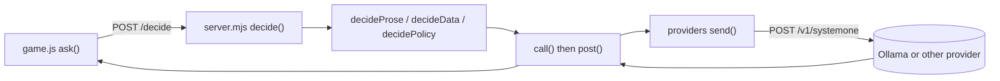

# Code walkthrough

A short map for finding the model calls. Every call ends up in one place on the server; the browser never talks to the model directly.

Each file starts with a comment saying what it is for, and has `// @ts-check` with JSDoc types. `jsconfig.json` turns on type checking in editors. There is no build step and there are no dependencies: the pages load plain ES modules.

## One decision, end to end

1. **Browser (`lander/game.js`, loaded by `lander/index.html`).** `ask()` sends the current ship state to the game's server as `POST /decide`. When the reply arrives, `applyDecision()` puts the chosen controls on the ship, and `renderHow()` fills the right-hand "how the model sees it" panel. `frame()` runs the physics and drawing on every animation frame. Between the reply and the engine sits the pilot loop (`lander/pilot-loop.mjs`, `createPilotLoop()`): `shouldSend()` enforces the decision rate in sim time, `send()` picks the state to send (predicted ahead with `predictShip()` when latency compensation is on), `receive()` sets the targets or discards a reply that is too old, and `stepShip()` eases the controls toward the targets and applies the burn lease, climb guard and touchdown leveling (`touchdownTilt`: within `levelHeight` m of the ground below, tilt goes to center) before calling `step()`.
2. **Server routes (`lander/server.mjs`).** `route()` sends `/decide` to `handleDecide()`, which calls `decide()`. `decide()` picks the mode: `decideProse()`, `decideData()` or `decidePolicy()`.
3. **The model call.** In prose mode, `decideProse()` first reuses the last answer when the body is identical and under 1 sim-second old (the same-scene skip). Otherwise each mode builds its request and calls `call()` in `server.mjs`. That calls `post()`, which tries the primary host and falls back to the secondary (`fallbackHostFor()`). The single `fetch` to `/v1/systemone` is `send()` in `lander/providers/index.mjs`, which also defines how each provider (Ollama, Jev, Microsoft Decision-1, OpenRouter) wants its request shaped.

## Prose mode (the default)

- `lander/prose.mjs`. `perceive()` turns the physics into plain sentences (`padSentence()`, `altSentence()`, `approachSentence()`, `terrainSentence()`, using the `BANDS` table); this is the part standing in for a vision model. `terrainSentence()` uses `highestGroundToward()` so the prose can say there is a ridge ahead (higher than you / just below / clear). `proseMap()` turns the model's choices into a target sideways speed, a tilt and a throttle. In the final-approach zone (`inFinalApproach()`: below 18 m above the target pad, within 15 m of its edges), `perceive()` returns `finalApproachScene()` instead. That scene gives where the legs are relative to the pad edges, the height in fine bands, the sink and slide as impressions, and the lean. `questionsFor()` then picks the `final_approach` questions from `prose.json`.
- `lander/modes/prose.json` holds the three choice questions and their option descriptions, sent as-is. When the pads layout is on (`?pads=1` / `LAYOUT=pads`), it also has a `pad_choice` question. `decideProse()` calls `choosePad()` (server) when `padChoiceDue()` says so; that builds state with `padChoiceState()` and re-asks every `review_seconds` (default 5 sim s) until the ship is near the target and low. The pad call's full request and response come back in `decision.pad.upstream`, and the game logs it as its own "pad choice" entry in the call history.

## Everything else

- **Physics and scoring:** `lander/sim.mjs`. `step()` moves the ship, `landingScore()` scores a landing, `randomStart(seed)` makes a random start (seeded by `createSeededRandom()`), and `dataMap()` / `dataThrust()` are the data mode's lookup tables. The data mode's yes/no questions are `DATA_QUESTIONS`, asked in order. Flat approach zones (`APPROACH`) keep pad-height ground beside every pad because the model cannot see terrain.
- **Policy mode:** `lander/policy.mjs` builds the ship JSON (`shipJSON()`), defines the four questions (`POLICY_QUESTIONS`) and maps answers to controls (`policyMap()`). Policy texts are in `lander/modes/policies/`.
- **Playground:** `lander/playground.js` (loaded by `lander/playground.html`) calls the server's `/api/systemone` route. On the server, `playground()` checks the body with `validateBody()` and forwards it with `send()`. The examples come from `lander/examples.mjs`.
- **Styles:** `lander/game.css` and `lander/playground.css`.
- **Providers and config:** `lander/providers/index.mjs` (`hostTable()`, `send()`) and `lander/env.mjs` (reads `.env`).
- **Without a browser:** `lander/tools/headless.mjs` flies the game from the command line by calling `decide()` directly (`flyOne()` per start), through the same pilot loop in sim time (env `DECISION_RATE`, `SMOOTHING`, `LATENCY_COMP`, `IMPULSE_LIMITS`, `DELAY_MS`). `lander/tools/proseprobe.mjs` tests the prose questions on single sentences. `hello.mjs` is the bare `/v1/systemone` call with nothing around it.

Tuning tables and landing logs: [results.md](results.md).
