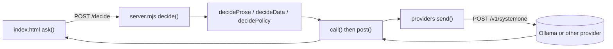

# Code walkthrough

A short map for finding the model calls. Every call ends up in one place on the server; the browser never talks to the model directly.

## One decision, end to end

1. **Browser (`lander/index.html`).** `ask()` sends the current ship state to the game's server as `POST /decide`. When the reply arrives, `apply()` puts the chosen controls on the ship, and `renderHow()` fills the right-hand "how the model sees it" panel.
2. **Server routes (`lander/server.mjs`).** The `/decide` route hands off to `decide()`, which picks the mode: `decideProse()`, `decideData()` or `decidePolicy()`.
3. **The model call.** Each mode builds its request and calls `call()` in `server.mjs`. That calls `post()`, which tries the primary host and falls back to the secondary. The single `fetch` to `/v1/systemone` is `send()` in `lander/providers/index.mjs`, which also defines how each provider (Ollama, Jev, Microsoft Decision-1, OpenRouter) wants its request shaped.

## Prose mode (the default)

- `lander/prose.mjs` (about 30 lines). `perceive()` turns the physics into two plain sentences; this is the part standing in for a vision model. `proseMap()` turns the model's choices into a target sideways speed and a throttle.
- `lander/modes/prose.json` holds the three choice questions and their option descriptions, sent as-is.

## Everything else

- **Physics and scoring:** `lander/sim.mjs`. `step()` moves the ship, `landingScore()` scores a landing, `randomStart(seed)` makes a random start, and `dataMap()` is the data mode's lookup table.
- **Policy mode:** `lander/policy.mjs` builds the ship JSON (`shipJSON()`) and maps answers to controls (`policyMap()`). Policy texts are in `lander/modes/policies/`.
- **Playground:** `lander/playground.html` calls the server's `/api/systemone` route, which goes through `playground()` and the same `post()` in `server.mjs`.
- **Providers and config:** `lander/providers/index.mjs` and `lander/env.mjs` (reads `.env`).
- **Without a browser:** `lander/tools/headless.mjs` flies the game from the command line by calling `decide()` directly. `hello.mjs` is the bare `/v1/systemone` call with nothing around it.
